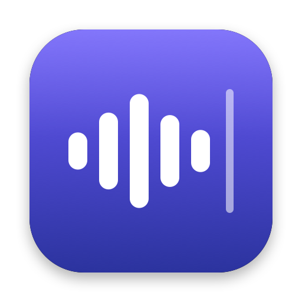

<p align="center">
  
</p>

<h1 align="center">voxim</h1>

<p align="center">
  <b>Hold fn. Speak. Release. Your words appear wherever you're typing.</b><br>
  Private, on-device push-to-talk dictation for macOS.
</p>

---

voxim is a tiny menu-bar app that turns the **fn** key into a push-to-talk button for every text field on your Mac: editors, browsers, chat apps, terminals. Speech is transcribed **locally** with NVIDIA's Parakeet model via Core ML. Nothing is uploaded, and no audio or text is ever stored.

## Why voxim

- **Fast.** The text is typed about 0.3 s after you let go, even after two minutes of talking.
- **Accurate on developer speak.** It gets "README", "npm", "auth middleware" and "async/await" right, where the built-in engine stumbles (see [benchmarks](#benchmarks)).
- **Private by design.** All transcription happens on your Mac. Audio is held in memory only until it's transcribed, and the optional usage stats contain counts and timings only, never what you said.
- **Works everywhere you type.** It types at the cursor in any app. It never presses Return for you, so nothing gets sent by accident.
- **Formats for where you are.** Mid-sentence it adds the space and drops the capital. In a terminal it drops the trailing period ("Git status." → `git status`).
- **English and 中文.** Auto mode detects the language each time you speak: English goes to Parakeet, Chinese and mixed speech ("帮我跑一下 unit tests") to SenseVoice. Simplified or Traditional output.
- **Teach it your words.** "When I say *T mux*, type *tmux*" rules fix the names and jargon it keeps getting wrong.
- **Safe by default.** It won't type into password fields. If you switch to another app mid-dictation, typing pauses and picks up where it left off when you come back; it never types into the wrong app.

## How it works

1. **Hold fn.** The microphone starts the moment fn goes down, so your first word isn't clipped. Using fn for a shortcut (fn+←, fn+F5, …) never starts a dictation.
2. **Speak.** A small "Listening…" bar shows the words recognized so far as you talk. **Esc** cancels.
   Or **double-tap fn** to keep listening hands-free, idling quietly between sentences: tap fn to finish, Esc to cancel. By default it finishes after 5 minutes of silence or 1 hour (configurable, including never).
3. **Pause or release.** Each sentence is typed at the cursor as soon as you pause ("Type as you speak"; terminals get everything at release). Your vocabulary rules and formatting are applied, and your clipboard is restored afterwards.

## Benchmarks

Measured on an M4 Max with synthesized speech (clean audio). Real-microphone accuracy will be lower. Details: [`docs/asr-spike.md`](docs/asr-spike.md).

| | Parakeet TDT v2 (default) | Apple on-device (fallback) |
|---|---|---|
| Word error rate, short coding commands | **7.3%** | 15.5% |
| Word error rate, 1–2 min monologues | **1.0%** | 3.5% |
| Release → text, 3 s phrase | **~40 ms** | ~60 ms |
| Release → text, 133 s monologue | **~0.3 s** | ~1.4 s |

## Install

**[Download the latest release](https://github.com/tendant/voxim/releases/latest)**, open the DMG and drag voxim to Applications. Releases are signed and notarized by Apple.

<details>
<summary>Build from source instead</summary>

```sh
git clone https://github.com/tendant/voxim.git
cd voxim
scripts/install.sh --adhoc     # no Apple Developer account needed
```

With an Apple Developer ID certificate, `VOXIM_TEAM_ID=<your team> scripts/install.sh` signs the build properly, so macOS keeps voxim's permissions across reinstalls. Building requires Xcode 26.
</details>

**Requirements:** macOS 26 (Tahoe) on Apple silicon.

**First run:**

1. Grant **Accessibility** (to see the fn key and type into apps) and **Microphone**. The menu-bar checklist shows anything missing.
2. Set **System Settings › Keyboard › "Press 🌐 key to"** to **Do Nothing**. Otherwise releasing fn also triggers that action.
3. The speech model (~450 MB) downloads once in the background. Apple's on-device speech is used until it's ready.
4. Optional: turn on **Launch at login** from the menu.

## Settings

The menu-bar menu shows status, anything that still needs setting up, and the Language picker. Everything else is in **Settings… › General**:


- **Language:** English, Auto (EN + 中文), or 中文. Chinese modes download a second ~450 MB model once.
- **Smart formatting:** context-aware spacing and capitalization, plus terminal style. Chinese text gets no stray spaces, and optionally a space between 中文 and English.
- **Double-tap fn for hands-free:** lock recording on without holding fn.
- **Capture from fn press:** keeps audio from the moment fn goes down. Turn it off if you'd rather the mic indicator not flash on every fn press, or if your Bluetooth headset switches to call quality.
- **Vocabulary:** "when I say → type" rules, with a live preview.
- **Usage:** local success rate, latency percentiles and failure reasons for the last 90 days. Never any text.

## Development

Open `voxim.xcodeproj` and run the `voxim` scheme. Debug builds are a separate app ("voxim Dev", `ai.weilabs.voxim.debug`) with their own permissions, and the most recently launched copy takes over fn. Run the unit tests with `xcodebuild -scheme voxim -only-testing:voximTests test`.

Releases: `scripts/release.sh <version>` builds, notarizes and publishes a DMG. Setup and steps: [`docs/releasing.md`](docs/releasing.md).

Design notes and roadmap: [`docs/implementation-plan.md`](docs/implementation-plan.md).

## Acknowledgements

- [FluidAudio](https://github.com/FluidInference/FluidAudio) (Apache-2.0) runs Parakeet on Core ML.
- [Parakeet TDT 0.6B v2](https://huggingface.co/nvidia/parakeet-tdt-0.6b-v2) by NVIDIA (CC-BY-4.0) is the English speech recognition model.
- [SenseVoice Small](https://github.com/FunAudioLLM/SenseVoice) by Alibaba FunAudioLLM recognizes Chinese and detects the language.

## License

voxim is released under the [MIT License](LICENSE). The Parakeet model it downloads is licensed separately by NVIDIA under CC-BY-4.0.
